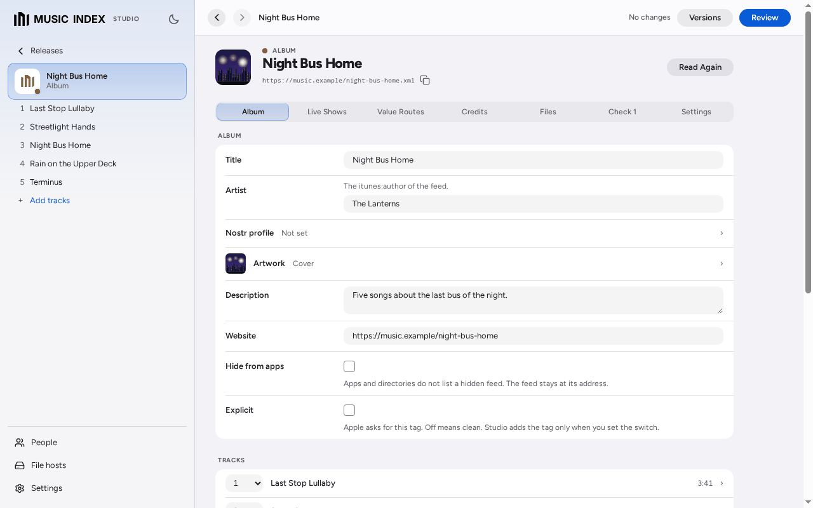

# Music Index Studio

Edit your music feeds in one location, and write each change to your file host.

## Who it is for

Studio is for an artist or a label that publishes music as Podcasting 2.0 feeds.
You keep your albums, your artist page and your label page in Studio. You see each change before Studio writes it.

## Try it

1. Download the installer for your computer from the newest release on the [GitHub Releases](https://github.com/InTheMorning/musicindex-studio/releases) page: the AppImage on Linux, the DMG on macOS or the MSI on Windows.
2. Open the installer. On Linux, make the AppImage executable (`chmod +x` and the file name), then open it. The installers have no code signature. On macOS and Windows, [Start Music Index Studio](docs/runbooks/install-desktop.md) tells you how to open the app the first time.
3. On the page "Where Studio keeps your releases", select **Use This Folder**, then **Continue**. See [Set up Studio for the first time](docs/user-guide/first-run.md).
4. Select **I make music**. Type your artist name, then select **Continue** two times. Studio makes your artist page.
5. Select **Review**, then **Write to the File Host**. Studio writes your artist page as a feed file in the folder `~/musicindex/pages` on your computer.

This folder is not on the web. To publish your pages, give the folder a public address, or move your releases to a file host with a public address. See [Connect a file host](docs/user-guide/hosts.md).

Next, add your first album: see [Start your artist page or label page](docs/user-guide/first-steps.md).
To start Studio from the source code, see [Start Studio on your computer](docs/user-guide/start-on-desktop.md).

## What it does today

- Opens your albums, playlists, artist pages and label pages, and edits each field that MSP 2.0 edits.
- Makes new releases from your audio files, with an MP3 file and a lossless alternative.
- Writes to a folder on your computer, SFTP, S3 and R2, Blossom and nsite.
- Shows each change before it writes, and keeps each earlier version of a feed.
- Edits the value routes (the Lightning payments) and the credits of your feeds, and keeps a list of the persons that you pay or credit.
- Moves a release to a different file host, and keeps the files on the first file host until you remove them.
- Checks a feed for problems, and gives a repair.
- Runs live shows, and lets a connected app change a live show while you stay in control.
- Tells Podcast Index after each write.

Studio also runs on a server, for use from a phone. See [Use Studio from a phone](docs/user-guide/use-on-a-phone.md).

## Documentation

- [The Studio user guide](docs/user-guide/README.md): all pages, grouped by task.
- Learn: [How Studio works](docs/user-guide/how-studio-works.md)
- Do a task: [Make a new release](docs/user-guide/new-release.md), [Add feeds that you already have](docs/user-guide/add-feeds.md), [Review and write your changes](docs/user-guide/review-and-write.md)
- Look up: [Connect a file host](docs/user-guide/hosts.md), [Value routes](docs/user-guide/value-routes.md)
- Understand: [Passphrase, unlock and lock](docs/user-guide/vault.md)

For a developer or a host operator: [the project documents](docs/README.md).

## The suite

| Project | How it connects to Studio |
| --- | --- |
| Music Index (musicindex.org) | Studio searches it to find artists, labels and persons. |
| Stophammer | The index behind Music Index. It reads the feeds that Studio writes. |
| HitIt | A player for listeners and show hosts. It plays the feeds that Studio writes. |
| musicindex-live-publisher | A connected app. It changes a live show in Studio with a show grant. |

## Status

Studio 0.1.0 is in testing. Each release on the GitHub Releases page is a release candidate. Keep a copy of your data folder before each update. [Start Music Index Studio](docs/runbooks/install-desktop.md) gives the folder of each system.

## License

AGPL-3.0. See [LICENSE](LICENSE).
